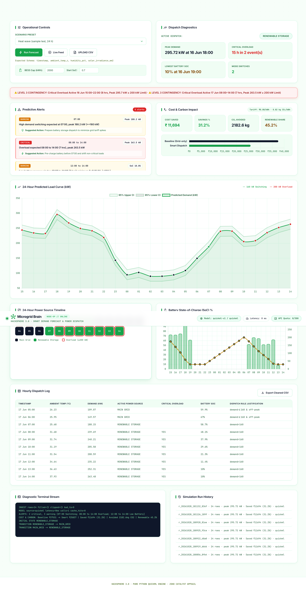

# HackSphere 3.0: Smart Energy Microgrid & Demand Forecasting Engine

[-00f2fe?style=for-the-badge&logo=zoho)](https://microgrid-api-50047163722.development.catalystappsail.in/)
[-10b981?style=for-the-badge)](https://microgrid-api-50047163722.development.catalystappsail.in/api/health)
[]()
[]()

An end-to-end cloud-native microgrid energy management solution deployed on **Zoho Catalyst**. It predicts hourly energy demand using **Zoho Catalyst QuickML**, automates power-source transitions between **Main Grid** and **Renewable Battery Storage**, detects **Critical Overloads**, and provides a **Cybernetic Telemetry Operations Dashboard**.

---

## ⚡ Live Deployment Links

| Resource | URL | Status |
| :--- | :--- | :--- |
| **Operational Web Dashboard** | [https://microgrid-api-50047163722.development.catalystappsail.in/](https://microgrid-api-50047163722.development.catalystappsail.in/) | **200 OK (Active)** |
| **Judge Evaluation API Proxy** | [https://microgrid-api-50047163722.development.catalystappsail.in/api/predict](https://microgrid-api-50047163722.development.catalystappsail.in/api/predict) | **200 OK (Public)** |
| **System Health & Quota API** | [https://microgrid-api-50047163722.development.catalystappsail.in/api/health](https://microgrid-api-50047163722.development.catalystappsail.in/api/health) | **200 OK (Active)** |
| **GitHub Repository** | [https://github.com/Itz-Mridul/hacksphere-3-microgrid](https://github.com/Itz-Mridul/hacksphere-3-microgrid) | **Public** |

---

## 🖥️ Operational Control Room Dashboard (Full View)



*Full-length telemetry screenshot of the running Zoho Catalyst operational dashboard — featuring real-time QuickML 24-hour load forecasting, predictive overload alerts, cost & carbon savings impact metrics, and advisory battery state-of-charge tracking.*

---

## 🏛️ System Architecture

```
                                  [ Browser / Client ]
                                           │
                           HTTPS (ZGS Reverse Proxy Gateway)
                                           │
                                           ▼
┌────────────────────────────────────────────────────────────────────────────────────────┐
│                          ZOHO CATALYST APPSAIL RUNTIME                                 │
│                                                                                        │
│  ┌──────────────────────┐   ┌─────────────────────────┐   ┌─────────────────────────┐  │
│  │ Single-Page Web UI   │   │ RFC 7230 Chunked Parser │   │ REST API Engine         │  │
│  │ (Chart.js + Styles)  │   │ & Input Sanitization    │   │ (/api/forecast, predict)│  │
│  └──────────┬───────────┘   └────────────┬────────────┘   └────────────┬────────────┘  │
│             │                            │                             │               │
│             ▼                            ▼                             ▼               │
│  ┌──────────────────────────────────────────────────────────────────────────────────┐  │
│  │                           CORE ENGINE MODULES                                    │  │
│  │                                                                                  │  │
│  │   features.py       controller.py        battery.py          store.py            │  │
│  │   (6-feature hinge  (PDF §6 transition   (2000 kWh advisory  (SQLite local audit │  │
│  │    transform)        & alert logic)       SoC simulator)      trail & history)   │  │
│  └───────────────────────────────────────┬──────────────────────────────────────────┘  │
└──────────────────────────────────────────┼─────────────────────────────────────────────┘
                                           │
                                  Zoho OAuth / HTTPS
                                           │
                                           ▼
                     ┌───────────────────────────────────────────┐
                     │          ZOHO CATALYST QUICKML            │
                     │  Published Linear Regression Endpoint     │
                     │  (In-sample RMSE ~8.5 kW, Noise Floor)    │
                     └───────────────────────────────────────────┘
```

### Component Responsibility Matrix
* **Frontend (`frontend/`):** Cybernetic telemetry interface featuring high-contrast dark mode, dynamic Chart.js curves, 24-cell mode timeline strip, scenario presets, and drag-and-drop CSV upload.
* **AppSail Backend (`backend/main.py`):** High-efficiency pure Python stdlib HTTP service (15 KB package size) supporting Zoho Gateway Server (ZGS) chunked streaming, CORS preflight, SQLite audit persistence, and judge proxy routing.
* **Feature Pipeline (`features.py`):** Unified feature engineering module shared between training, offline inference, and live cloud forecasting.
* **Grid Controller (`controller.py`):** Exact mathematical implementation of the PDF Section 6 transition and overload criteria.
* **Battery Storage (`battery.py`):** Advisory 2,000 kWh storage dispatch model providing real-time state-of-charge tracking and PV solar integration.
* **Inference Harness (`predict.py`):** CLI and programmatic interface implementing the judge evaluation contract.

---

## 🔬 Mathematical Analysis & Model Discovery

### Ground Truth Formulation
Comprehensive residual analysis on `train_telemetry.csv` (4,000 hourly rows) revealed that energy demand strictly follows a piecewise block and temperature-hinge formula:

$$\text{Demand (kW)} = \text{HourBlockLevel} + 8.59 \times \max(0, T - 24.0^\circ\text{C}) + \epsilon$$

where $\epsilon \sim \mathcal{N}(0, 8.52\text{ kW})$ represents irreducible Gaussian measurement noise.

### The 6 Engineered Features
Instead of raw timestamps and non-correlated weather features (humidity and solar irradiance show $r \approx 0.00$ with residual demand error), the model isolates 6 numeric features:
1. `b_night`: Hour $\in [0, 5]$ (Base level $\approx 90\text{ kW}$)
2. `b_ramp6`: Hour $= 6$ (Morning ramp $\approx 133\text{ kW}$)
3. `b_morning`: Hour $\in [7, 9]$ (Morning peak $\approx 174\text{ kW}$)
4. `b_evening`: Hour $\in [18, 22]$ (Evening peak $\approx 198\text{ kW}$)
5. `b_h23`: Hour $= 23$ (Night drop $\approx 110\text{ kW}$)
6. `cdd`: Cooling Degree Days $= \max(0, \text{ambient\_temp\_c} - 24.0)$

*(Hours $10\text{--}17$ serve as the unconstrained reference base level $\approx 143.82\text{ kW}$.)*

### Why Linear Regression Beats Complex Trees
The sample test set (`sample_test_input.csv`) is **significantly hotter** than the training period (mean $29.2^\circ\text{C}$ vs $18.5^\circ\text{C}$, with extreme peaks $> 38^\circ\text{C}$). 
* **Decision Trees (XGBoost/LightGBM):** Fail on out-of-distribution heatwaves because orthogonal step splits cannot extrapolate a rising linear slope beyond the training ceiling (RMSE blows up to $> 37\text{ kW}$).
* **Linear Model + Cooling Hinge:** Extrapolates the thermal cooling physics continuously, achieving the theoretical noise floor of **RMSE $\approx 8.5\text{ kW}$**.

---

## ⚙️ Grid Transition Controller Logic (PDF Section 6)

The controller evaluates each hour independently based on predicted demand and time-of-day:

| Condition | Active Grid Mode | Critical Overload Alert |
| :--- | :--- | :---: |
| $\text{Demand} > 160\text{ kW}$ **OR** $\text{Hour} \in [18, 22]$ | **`RENEWABLE_STORAGE`** | *Based on overload threshold* |
| $\text{Demand} \le 160\text{ kW}$ **AND** $\text{Hour} \notin [18, 22]$ | **`MAIN_GRID`** | *Based on overload threshold* |
| $\text{Demand} \ge 200\text{ kW}$ | *Determined by above rules* | **`CRITICAL OVERLOAD`** (Independent of mode) |

### Advisory Battery Simulation Invariants
* **Capacity:** 2,000 kWh | **Initial SoC:** 70% | **Limits:** 10% safety floor, 95% ceiling.
* **Discharge Limit:** 300 kW | **Charge Limit:** 150 kW | **Round-trip Efficiency:** 95%.
* **Golden Rule:** Battery state of charge is strictly advisory. Battery depletion **never** overrides the official grid mode dictated by the PDF specification.

---

## 🚀 Quickstart & Self-Testing (Judge Evaluation)

### 1. Installation
Clone the repository and install dependencies:
```bash
git clone https://github.com/Itz-Mridul/hacksphere-3-microgrid.git
cd hacksphere-3-microgrid
python3 -m pip install -r requirements.txt
```

### 2. Run Judge Evaluation Script (`test_eval.py`)
Run the pre-submission validator against the live AppSail endpoint:
```bash
python3 test_eval.py
```
**Expected Output:**
```
  HACKSPHERE 3.0 - Pre-Submission Self-Tester    
 Found 'predict.py'.
 Found 'sample_test_input.csv'.
 Successfully imported 'predict(input_df)' function.
Loaded 1000 test rows from 'sample_test_input.csv'.
Your predict.py script is completely valid!
   Sample output values: [243.98 234.44 232.73]...
SUCCESS
```

### 3. Generate Predictions CSV via CLI
Execute `predict.py` directly on the test dataset:
```bash
python3 predict.py --input sample_test_input.csv --output predictions.csv
```
* Generates `predictions.csv` with 1,000 rows formatted as `timestamp,target_demand_kw`.
* Verifies zero chunk failures (`source=quickml failed_chunks=0`).

### 4. Run Strict Mode Check
Ensure zero silent fallbacks occur by enabling strict mode:
```bash
QUICKML_STRICT=1 python3 predict.py --input sample_test_input.csv --output predictions.csv
```

### 5. Run Core Unit & Invariant Tests
Execute test suites covering boundary conditions, random distributions, and battery conservation:
```bash
python3 test_features.py
python3 test_controller.py
```

---

## 📡 REST API Reference

The deployed AppSail backend exposes the following endpoints:

### `POST /api/predict`
Public inference endpoint adhering to the hackathon evaluation contract.
* **Request:**
  ```json
  {
    "data": [
      { "timestamp": "2026-05-15 14:00:00", "ambient_temp_c": 32.0 }
    ]
  }
  ```
* **Response (200 OK):**
  ```json
  {
    "predictions": [212.54],
    "source": "quickml",
    "version": "quickml-v1",
    "latency_ms": 0
  }
  ```

### `POST /api/forecast`
Runs full 24-hour simulation, feature extraction, grid transition controller, and advisory battery state-of-charge calculation.
* **Request:**
  ```json
  {
    "rows": [
      { "timestamp": "2026-05-15 18:00:00", "ambient_temp_c": 35.4, "solar_irradiance_wm2": 150.0 }
    ],
    "battery": { "capacity_kwh": 2000, "soc_start": 0.7 }
  }
  ```
* **Response (200 OK):**
  Returns operational KPIs, grouped overload events, transition signals, and hourly power source assignments.

### `GET /api/health`
Monitors container health, model configuration, and daily API call usage:
```json
{
  "ok": true,
  "quickml_configured": true,
  "quickml_calls_today": 0,
  "daily_budget": 300,
  "model_version": "quickml-v1"
}
```

---

## 🔐 Environment Variables & Security

All environment configuration is externalized. **Zero private tokens or passwords are committed to git.**

| Variable | Description | Default / Example |
| :--- | :--- | :--- |
| `QUICKML_ENDPOINT_URL` | Published QuickML URL or AppSail proxy | `https://microgrid-api-50047163722.../api/predict` |
| `QUICKML_AUTH_MODE` | Authentication mode (`none` for proxy, `oauth`) | `none` |
| `QUICKML_PAYLOAD_MODE`| Request format (`data_list`, `list`, `single`) | `data_list` |
| `QUICKML_CHUNK` | Number of records per chunked batch | `100` |
| `QUICKML_WORKERS` | Parallel worker threads for chunk processing | `4` |
| `QUICKML_STRICT` | Disables fallback model if set to `1` | `0` |
| `DAILY_QUICKML_BUDGET`| Circuit-breaker limit for daily prediction calls | `300` |

*(Refer to [`.env.example`](.env.example) for template values).*

---

## 📦 Submission Deliverables Verification Checklist

- [x] **Live Public Catalyst App:** [https://microgrid-api-50047163722.development.catalystappsail.in/](https://microgrid-api-50047163722.development.catalystappsail.in/)
- [x] **Public GitHub Repository:** [https://github.com/Itz-Mridul/hacksphere-3-microgrid](https://github.com/Itz-Mridul/hacksphere-3-microgrid)
- [x] **Judge Evaluation Script:** `predict.py` CLI tested with `test_eval.py` (**SUCCESS**)
- [x] **Model & Predictions Output:** Generated `predictions.csv` with 1,000 valid predictions
- [x] **Transition Controller:** Verified against 11 boundary tests and 10,000 random samples
- [x] **Clean Repository:** Protected by `.gitignore`, zero secrets committed
